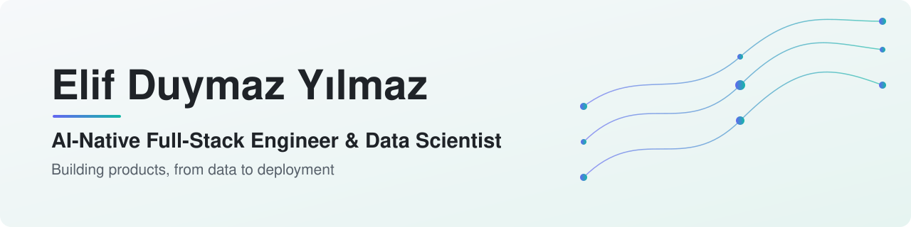
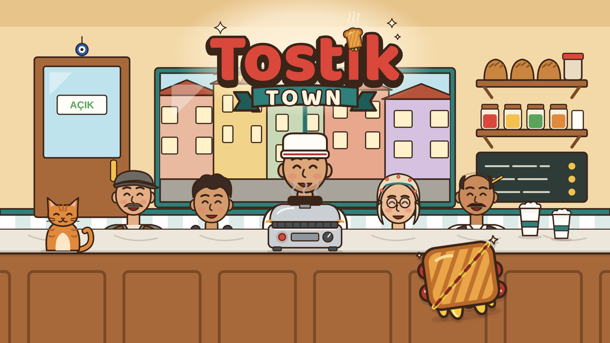
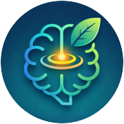
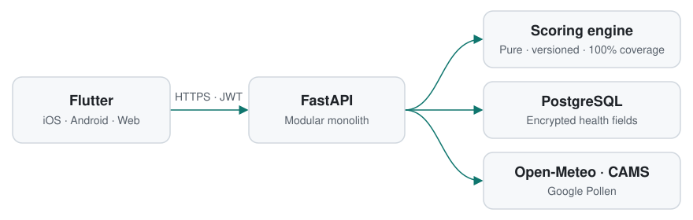
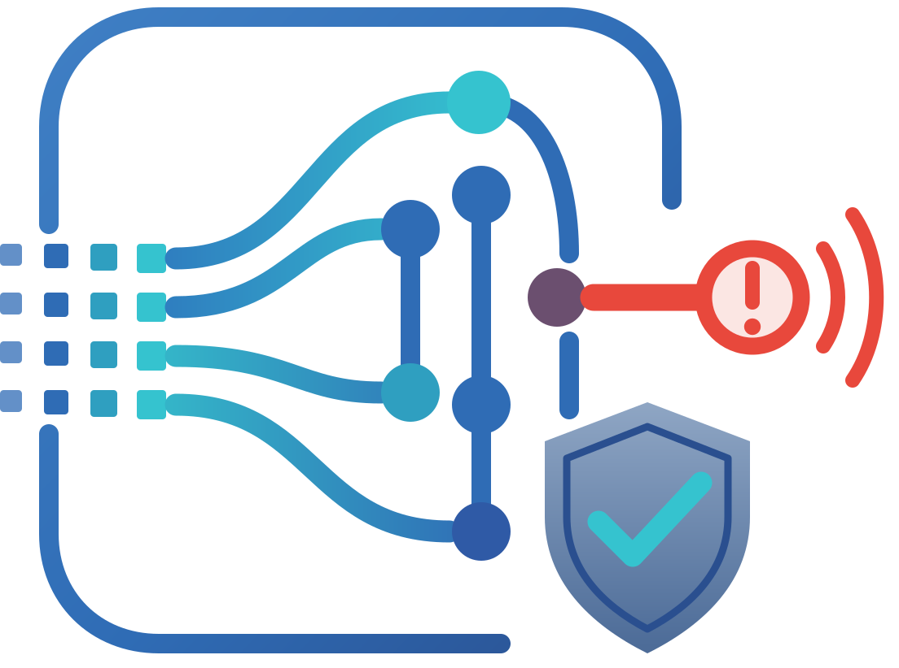

<picture>
  <source media="(prefers-color-scheme: dark)" srcset="assets/banner-dark.svg">
  <source media="(prefers-color-scheme: light)" srcset="assets/banner-light.svg">
  
</picture>

<b>🚴‍♀️ Keep pedaling, keep learning!</b>

**AI-Native Full-Stack Engineer & Data Scientist.** I build AI-powered products end to end: data pipelines, backends, mobile and web clients, and the delivery around them. My background runs from mathematics through bioengineering to AI engineering, so I treat software the way I treat research: state the assumption, measure it, and explain the result.

I currently work as an **AI Developer** and co-founded **Yilmaz Game Studio**, where we release browser games, starting with Tostik Town.

**[LinkedIn](https://www.linkedin.com/in/elif-duymaz/)** · **[Kaggle](https://www.kaggle.com/edyjui)** · **[Featured work](#featured-work)** · **[Experience](#experience)** · **[Data science](#data-science--research)**

---

## Featured work

### Tostik Town

  

A top-down toastie shop game for the browser, available in English and Turkish. Press every toastie by hand, serve the neighborhood and grow your tiny shop.

**Built with:** Phaser 4 · JavaScript · Python build and art tooling · original music synthesized live with the Web Audio API

**[▶ Play now](https://eustoregamestudio.github.io/tostik-town/)** · **[Release repository](https://github.com/eustoregamestudio/tostik-town)** · A EUStore Game Studio production

### allermind

A personalized, explainable daily outdoor allergy risk app in active development. It reads pollen, air quality, UV and weather against a person's own allergy profile and shows which hours of the day suit them best.

 

<picture>
  <source media="(prefers-color-scheme: dark)" srcset="assets/allermind-architecture-dark.svg">
  <source media="(prefers-color-scheme: light)" srcset="assets/allermind-architecture-light.svg">
  
</picture>

- **Explainable by design:** a pure, versioned scoring engine, so every result can be traced and reproduced.
- **Health data protected:** encrypted sensitive fields, a STRIDE threat model and KVKK and GDPR mapping.
- **Generated API contract:** the backend's OpenAPI schema generates the Dart client, and CI fails if either side drifts.

**Built with:** Flutter · FastAPI · SQLAlchemy · PostgreSQL · Terraform · Astro

**[allermind.com](https://allermind.com/tr/)**

### Fonfody

**Spotting financial risk before it becomes visible.** An explainable early-warning platform in active development for Türkiye's fund and banking data, designed to take the algorithm from my master's thesis to production grade.

- **Cross-channel design:** deposits, participation funds and investment funds in one regime-controlled model.
- **Evidence-bound AI by design:** a deterministic engine produces every score, and the LLM only narrates evidence verified on the server.
- **Earliness as the success metric:** a time-machine replay is designed to measure how many days earlier a signal appeared.
- **Built so far:** public-data connectors, a controlled vocabulary, observability and run tracking, and a Kubernetes data platform behind strict CI gates.

**Foundation:** Python · Kubernetes · Dagster · MLflow · Apache Iceberg · ClickHouse · Keycloak · Vault · GitHub Actions

**[fonfody.com](https://fonfody.com)**

---

## Experience

**AI Developer — Efsora · Vave Health** · Current 
Developing AI-powered software in a professional product team.

**Co-founder & Game Developer — [Yilmaz Game Studio](https://github.com/yilmazgamestudio)** · Current 
Designing, building and releasing browser games, starting with Tostik Town.

---

## Data science & research

| Project | What it shows |
|---|---|
| **[mirna-project](https://github.com/eduymaz/mirna-project)** | Automated R pipeline for Affymetrix data: RMA normalization, differential expression, pathway enrichment and miRNA target prediction for Methylmalonic Acidemia |
| **[Bioinformatics](https://github.com/eduymaz/Bioinformatics)** | Containerized single-cell RNA-seq pipeline with Docker, Seurat and Kallisto, an alternative splicing analysis, and spatial and multi-omics coursework |
| **[AI-Master-Degree](https://github.com/eduymaz/AI-Master-Degree)** | Master's coursework and research in computer vision, image processing, NLP and deep learning, including a [full-stack legal RAG system](https://github.com/eduymaz/AI-Master-Degree/tree/main/SEMESTER-II/ai-ethics-legal-rag) |
| **[machinelearning](https://github.com/eduymaz/machinelearning)** | Classical ML implementations and applied prediction projects, including PyTorch and TensorFlow models, from the Turkcell GYK program |
| **[power-bi-analytics](https://github.com/eduymaz/power-bi-analytics)** | Power BI coursework portfolio covering data preparation, data modeling and DAX |

---

## How I engineer

- **Decisions are written down.** Architecture decision records and requirements come before the code.
- **Shared contracts.** Generated schemas keep clients and services in step, and CI enforces them.
- **Determinism where it matters.** Scores come from tested engines, and AI explains the evidence.
- **AI-native delivery.** I build with AI agents throughout the development cycle, with automated review and quality gates on every change to my product repositories.
- **Privacy and security by default.** Threat models, data classification and secret scanning are part of the baseline.

---

## Tech stack

| Area | Tools |
|---|---|
| **Languages** | Python · TypeScript · JavaScript · Dart · R · SQL |
| **AI & LLM** | Claude API · Claude Code · PyTorch · TensorFlow |
| **Data science** | scikit-learn · SHAP · statsmodels · Power BI |
| **Backend** | FastAPI · Pydantic · SQLAlchemy · PostgreSQL |
| **Frontend & mobile** | Flutter · React · Astro · Phaser |
| **Infrastructure** | Docker · Terraform · Google Cloud · Firebase · GitHub Actions |
| **Bioinformatics** | Bioconductor · Seurat · Kallisto |

---

## Education

- **MSc, AI Engineering**
- **MSc, Bioengineering**
- **BSc, Mathematics**
- **BSc, Management Information Systems**
