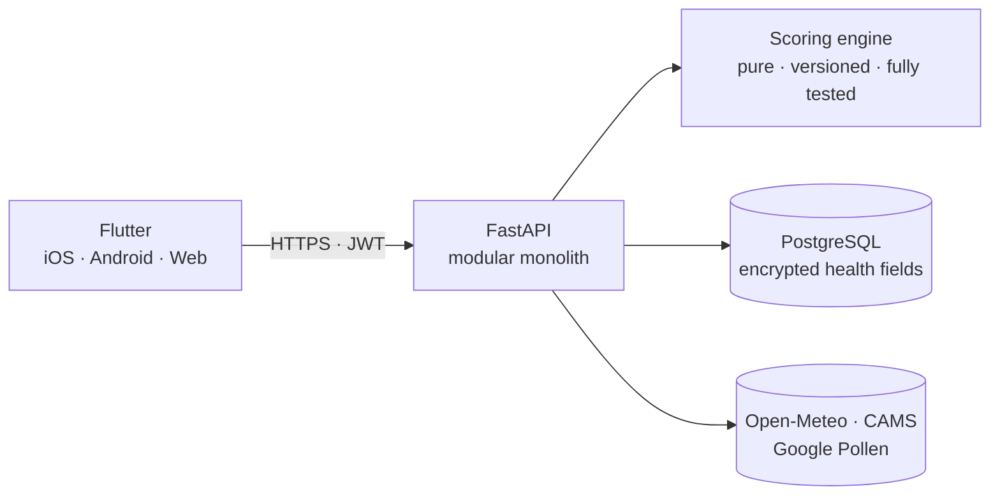

<picture>
  <source media="(prefers-color-scheme: dark)" srcset="assets/banner-dark.svg">
  <source media="(prefers-color-scheme: light)" srcset="assets/banner-light.svg">
  
</picture>

 

I build AI-powered products end to end: data pipelines, backends, mobile and web clients, and the delivery around them. My background runs from mathematics through bioengineering to AI engineering, so I treat software the way I treat research: state the assumption, measure it, and explain the result.

I currently work as an **AI Developer** and co-founded **Yilmaz Game Studio**, where I ship browser games.

**[LinkedIn](https://www.linkedin.com/in/elif-duymaz/)** · **[Kaggle](https://www.kaggle.com/edyjui)** · **[Featured products](#featured-products)** · **[Experience](#experience)** · **[Data science](#data-science--research)**

---

## Featured products

### Tostik Town

A top-down toastie shop game for the browser, available in English and Turkish. Press every toastie by hand, serve the neighborhood and grow your tiny shop.

**Built with:** Phaser 4 · JavaScript · Python build and art tooling · procedurally composed music

**[▶ Play now](https://yilmazgamestudio.github.io/tostik-town/)** · **[Repository](https://github.com/yilmazgamestudio/tostik-town)** · A Yilmaz Game Studio production

### allermind

Personalised, explainable daily outdoor allergy risk. It reads pollen, air quality, UV and weather against a person's own allergy profile and shows which hours of the day suit them best.

- **Explainable by design:** a pure, versioned scoring engine, so every result can be traced and reproduced.
- **Health data protected:** encrypted sensitive fields and a threat model covering KVKK and GDPR.
- **Contract-first API:** an OpenAPI contract generates the Dart client, and CI validates both sides.

**Built with:** Flutter · FastAPI · SQLAlchemy · PostgreSQL · Terraform · Astro

### Fonfody

**Spotting financial risk before it becomes visible.** An explainable early-warning platform for Türkiye's fund and banking data, taking the algorithm from my master's thesis to production grade.

- **Cross-channel view:** deposits, participation funds and investment funds in one regime-controlled model.
- **Evidence-bound AI assistant:** a deterministic engine produces every score, and the LLM only narrates evidence verified on the server.
- **Measured earliness:** a time-machine replay computes how many days earlier a signal appeared.

**Built with:** Python · FastAPI · polars · scikit-learn · SHAP · Dagster · MLflow · Apache Iceberg · ClickHouse · React · Claude API

**[fonfody.com](https://fonfody.com)**

### King Skor Takip

A free score tracker for the card game King, so players can focus on the table instead of the math. **[kingskortakip.com.tr](https://kingskortakip.com.tr/)**

---

## Experience

**AI Developer — Efsora · Vave Health** · Current 
Developing AI-powered software in a professional product team.

**Co-founder & Game Developer — [Yilmaz Game Studio](https://github.com/yilmazgamestudio)** · Current 
Designing, building and releasing browser games such as Tostik Town, and companion tools such as King Skor Takip.

---

## Data science & research

| Project | What it shows |
|---|---|
| **[mirna-project](https://github.com/eduymaz/mirna-project)** | Automated R pipeline for Affymetrix data: RMA normalization, differential expression, pathway enrichment and miRNA target prediction for Methylmalonic Acidemia |
| **[Bioinformatics](https://github.com/eduymaz/Bioinformatics)** | Containerized single-cell RNA-seq, alternative splicing, spatial and multi-omics workflows with Docker, Seurat and Kallisto |
| **[AI-Master-Degree](https://github.com/eduymaz/AI-Master-Degree)** | Master's coursework and research in computer vision, image processing, NLP and deep learning |
| **[machinelearning](https://github.com/eduymaz/machinelearning)** | Classical ML implementations and applied prediction projects |
| **[power-bi-analytics](https://github.com/eduymaz/power-bi-analytics)** | End-to-end BI reports covering data modeling and advanced DAX |

---

## How I engineer

- **Decisions are written down.** Architecture decision records and requirements come before the code.
- **Contracts first.** Shared schemas keep clients and services in step, and CI enforces them.
- **Determinism where it matters.** Scores come from tested engines, and AI explains the evidence.
- **AI-native delivery.** I build with AI agents throughout the development cycle, with review and automated quality gates on every change.
- **Privacy and security from day one.** Threat models, data classification and secret scanning are part of the baseline.

---

## Tech stack

| Area | Tools |
|---|---|
| **Languages** | Python · TypeScript · JavaScript · Dart · R · SQL |
| **AI & LLM** | Claude API · Claude Code · PyTorch · TensorFlow |
| **Data science** | polars · scikit-learn · SHAP · statsmodels · MLflow · Dagster · Power BI |
| **Backend** | FastAPI · Pydantic · SQLAlchemy · PostgreSQL · ClickHouse |
| **Frontend & mobile** | Flutter · React · Astro · Phaser |
| **Infrastructure** | Docker · Terraform · Google Cloud · Firebase · GitHub Actions |
| **Bioinformatics** | Bioconductor · Seurat · Kallisto |

---

## Education

- **MSc Candidate, AI Engineering**
- **MSc, Bioengineering**
- **BSc, Mathematics**
